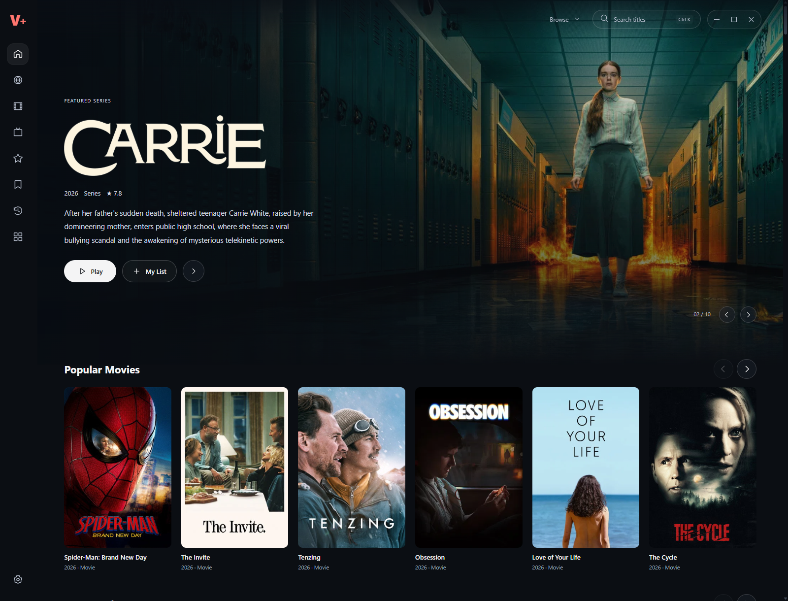
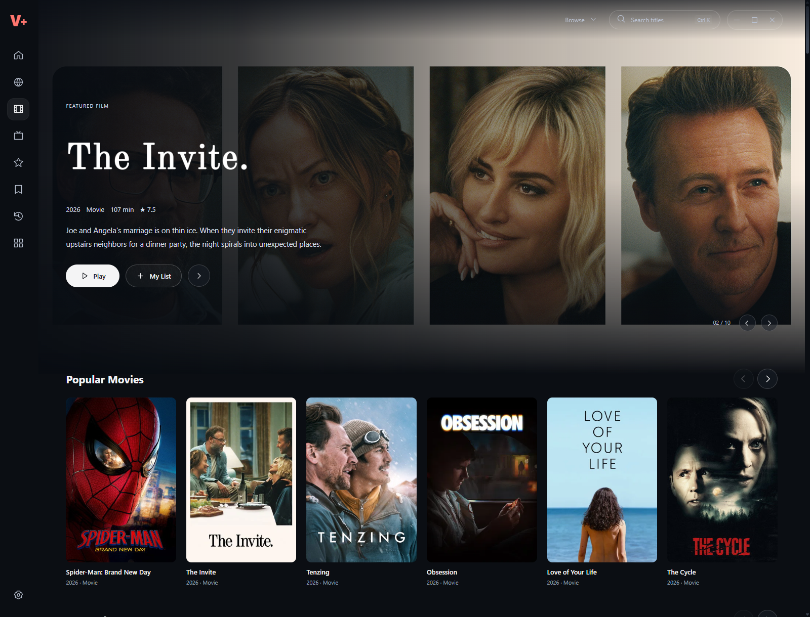
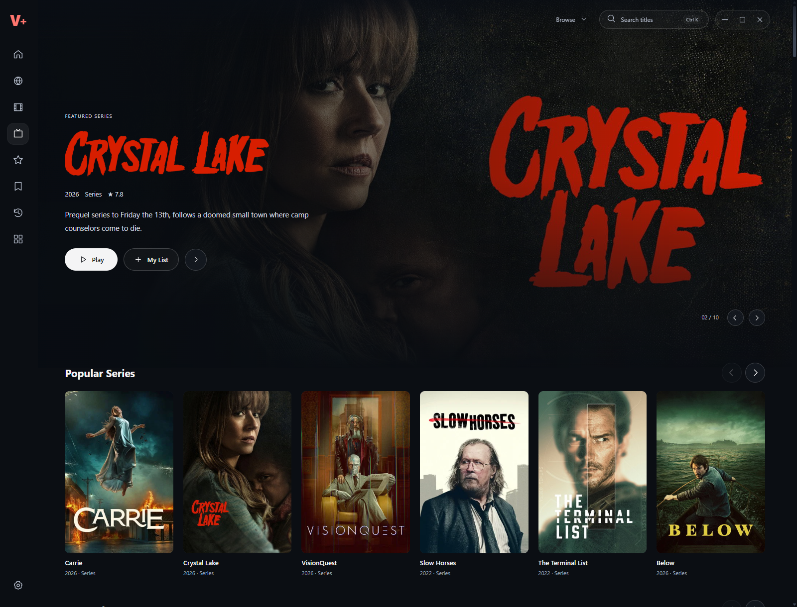
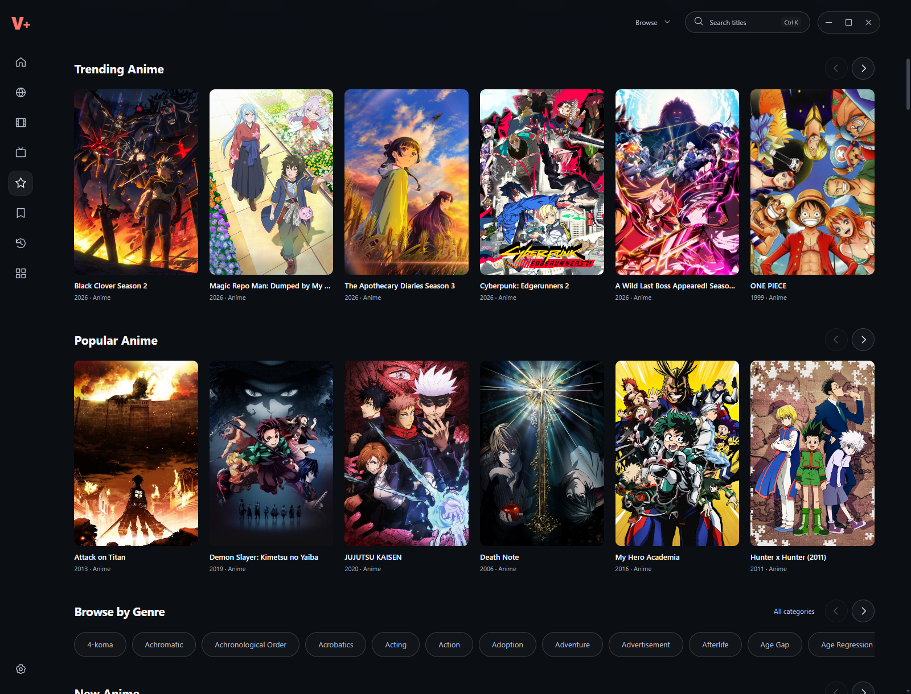
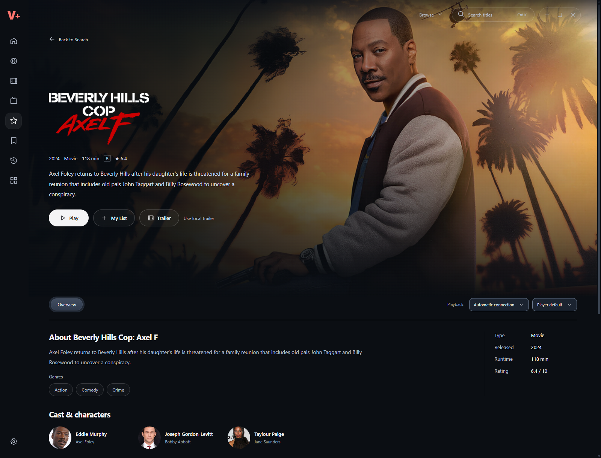
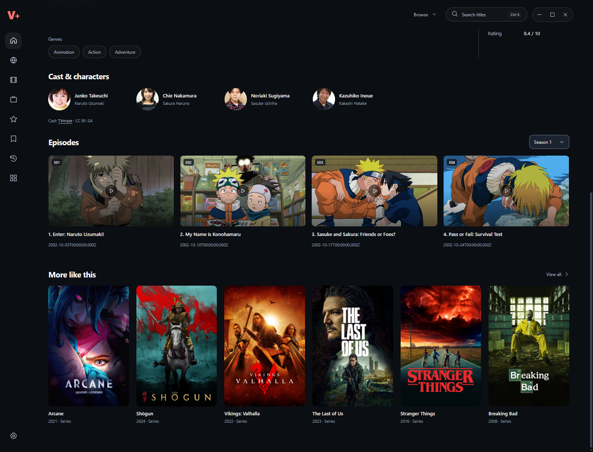

# V+

**A cinematic PC media app that connects discovery, title details and desktop playback.**

Independent product and interaction design by **Vishnu MK**, with AI-assisted implementation and verification. This repository contains the Windows application source and a dependable, limited browser demo.

[Read the case study](https://vishnu-mk-design.github.io/portfolio/vplus/index.html) · [Try the live demo](https://vishnu-mk-design.github.io/portfolio/vplus/demo/app/index.html)



## Two ways to explore

| Edition | What it contains | Requirements |
| --- | --- | --- |
| **Browser demo** | Three openly licensed films, live search, collections, My List, 45-second video excerpts, English captions and timeline previews | Node.js and a browser; no API token or account |
| **Windows source app** | Movie, series and anime discovery, title metadata, episodes, local tracking, desktop player and existing provider adapters | Windows, Node.js, npm and network access; provider availability varies |

The screenshots show the **real Windows 0.6.6 application**. They are not the three-film demo catalogue and do not guarantee that each displayed title has an available playback source.

## Run the browser demo

Install Node.js 22 or newer, then:

```sh
git clone https://github.com/Vishnu-MK-Design/vplus.git
cd vplus
npm run demo
```

Open **http://127.0.0.1:5289/** for the case study, or **http://127.0.0.1:5289/demo/app/index.html** for the demo. No dependency installation is needed for this static edition.

Try this short journey:

1. Search for **Tears of Steel** and open its details.
2. Add it to **My List**, then play the excerpt.
3. Turn on **English subtitles**. They are actual publisher-provided cues.
4. Hover over the timeline to see prepared video frames.
5. Return to browsing and reopen the film to resume.

My List, preferences and watch position stay in that browser’s local storage. The demo makes no third-party metadata or playback requests.

## Run the Windows application

From the repository root, in a Windows terminal:

```sh
npm ci --prefix windows
npm run desktop
```

The source edition uses its own **VPlus-Source** application-data folder, so testing it does not share the installed review app’s library. No developer credentials or user library are included. Optional TMDB credentials must be supplied by the person running the application; public metadata fallbacks remain available when supported.

To prepare assets, run unit tests, or build a Windows installer:

```sh
npm run prepare:desktop
npm test
npm --prefix windows run pack
```

Installer output goes to `dist/windows/`. Installers are not checked into this repository. Unsigned development builds may trigger the operating system’s usual trust prompt.

## What I worked on

- Cinematic discovery across movies, TV series and anime, with separate collection pages.
- Search-as-you-type suggestions that preserve the current page context.
- Mouse and keyboard playback behaviour separated from TV-style navigation.
- Reachable hover menus, neutral surfaces and pill-style Audio & Subtitles tabs.
- Captions anchored to the video frame instead of moving with option menus.
- Cached timeline previews, local playback progress and episode tracking.
- Clear distinctions between catalogue metadata, player connections and actual source availability.

<details>
<summary>More real application screenshots</summary>

### Movies


### Series


### Anime


### Title details


### Episodes


</details>

## Architecture

```text
windows/          Electron host, IPC, metadata orchestration, desktop UI/player and tests
shared/assets/    Source-owned helper scripts and seed catalogue metadata
shared/metadata/  Public catalogue, TMDB, IMDb and series metadata adapters
engines/cs3/      Optional extension-runtime transport interface; no engine/plugin binaries
public/           Case study, real application screenshots and licensed browser demo
tools/            Local static server
docs/             Architecture, attribution and verification scope
```

The PC renderer uses JavaScript and CSS. Electron owns windows, local storage and tightly scoped native requests. The desktop player shares a playback core while keeping its interaction adapter separate. The public browser demo reuses the production renderer/player with a small local media transport.

This is a **portable PC source export**, not the full historical development workspace. Relative build dependencies were moved into `shared/`; no Android SDK, paused Mobile/TV application, private research checkout or downloaded playback engine is required. Existing internal `vidly` names remain where changing them could alter stored identities or transport contracts.

## Boundaries and current limitations

- **Vidly, CineSrc, VidFast and VidLink** adapters exist in the Windows source. A registered adapter does not mean every title or feature works. Recorded VidFast requests failed upstream; tested VidLink subtitle files returned HTTP 403. See [verification scope](docs/VERIFICATION.md).
- **AnimeEmbed is not integrated.** Its real subtitle rendering remains unverified.
- Extension inventory is not the same as connected playback. Java engines, compiled third-party plugins and private resolver files are not distributed here.
- Windows discovery requires external metadata services. Network failures, upstream changes and rate limits can reduce results.
- Commercial posters, backdrops and cast photographs are **not bundled as standalone desktop runtime assets**. The source edition resolves available artwork through metadata services and handles missing artwork. The case study retains attributed application screenshots.
- Local progress is implemented; account-based cross-device sync is not.
- Mobile and TV development remain paused and are not part of this release.
- This is a review project, with no claim of universal playback reliability or production readiness.

## Credits and ownership

The interface was directed and iterated by Vishnu MK. Codex assisted implementation and testing. Public streaming interfaces and React Bits informed interaction/design references; V+ is independent and is not affiliated with those products.

The demo contains excerpts of **Tears of Steel**, **Big Buck Bunny** and **Elephants Dream**, under their respective Creative Commons licences. Read the [full media credits](public/credits.html) and [source/third-party attribution](docs/ATTRIBUTION.md). Commercial artwork inside native screenshots belongs to its respective rights holders; those screenshots are product documentation, not a licence to reuse the artwork or streams.

No new open-source licence is granted for the original application code. Public repository visibility does not by itself grant reuse rights. Third-party components and film assets retain their own licences. See [NOTICE](NOTICE.md).

---

[Vishnu MK’s portfolio](https://vishnu-mk-design.github.io/portfolio/) · [Case-study source](public/index.html) · [Report a reproducible issue](https://github.com/Vishnu-MK-Design/vplus/issues)
